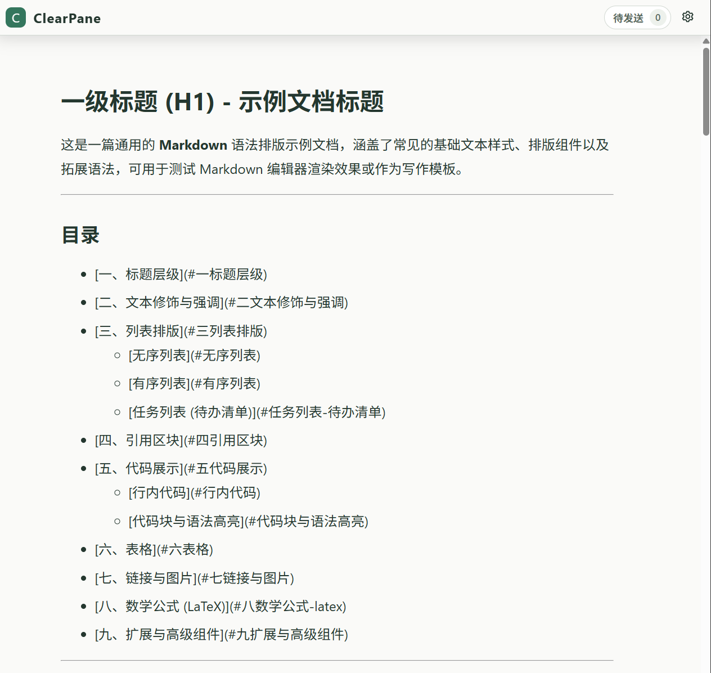
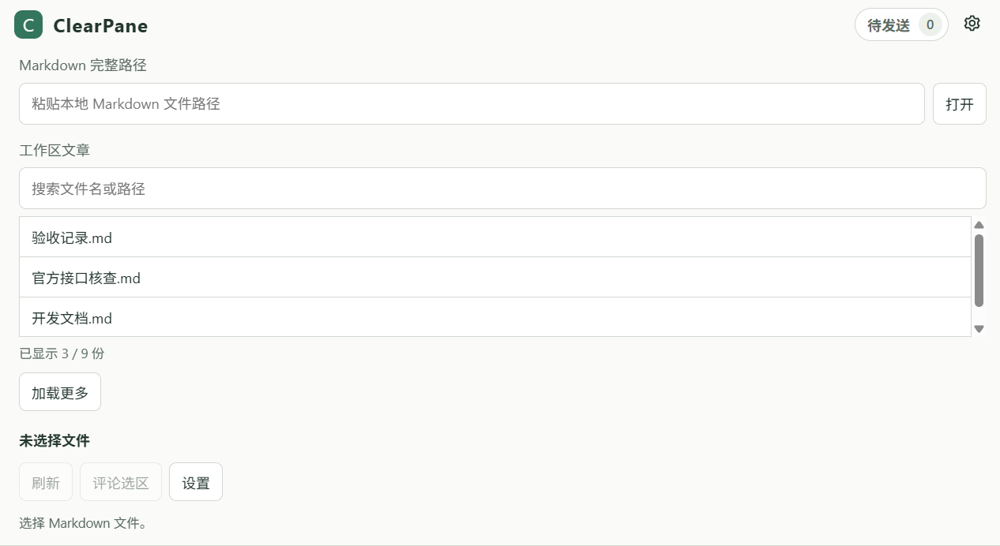
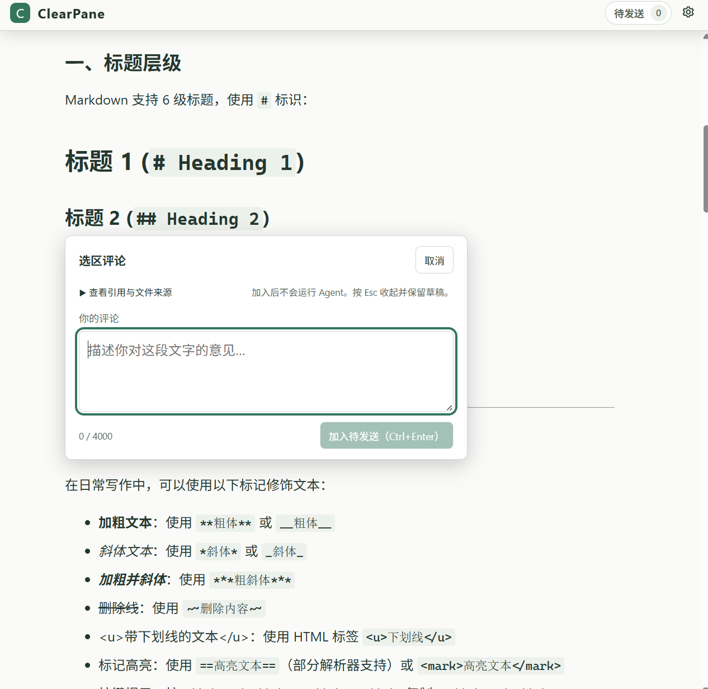

# Antigravity ClearPane

Antigravity ClearPane 是专为 Google Antigravity IDE 打造的官方辅助侧面板（Auxiliary Side Pane）Markdown 深度阅读与批量选区评审插件。

它让开发者与用户在与 AI Agent 协作时，能够在一个独立、舒适、实时同步且功能完整的专属侧边栏中阅读项目文档、设计方案与技术规格，并通过直接在正文中划词批注，将修改建议一次性批量反馈给 Agent，形成高效率的文档研读与评审闭环。

---

## 界面预览

### 沉浸式阅读与全功能渲染
支持优雅的排版布局、代码高亮、KaTeX 数学公式、Mermaid 流程图、只读任务清单，以及本地与网络图片自适应缩放展示。



### 舒适的排版定制与色彩模式
支持实时调节字号（14–22px）、行高（1.4–2.2），自动遵循最佳阅读行宽（最大 76ch），并可随心切换跟随宿主系统主题、深色或浅色模式。



### 划词批注与统一批量发送
在正文任意位置直接划选文字即可打开浮层填写修改建议。支持连续多处批注、原文高亮联动，并在待发送面板中填写统一指令，一次性合并提交给主会话。



---

## 为什么要做这个项目？

在日常使用 Antigravity 进行 AI 辅助编程或技术方案编写时，文档阅读与评审面临着几大难以忽视的痛点：

### 1. IDE 内置文档阅读体验割裂且疲劳
在代码编辑器里直接查看 Markdown，往往既占用了宝贵的主编辑区，又缺乏针对长文阅读的排版优化。密集的字行、僵硬的行距、缺乏自适应边距的窗口，长时间阅读极其容易产生视觉疲劳。此外，技术文档中常见的 KaTeX 数学公式、Mermaid 架构图、任务清单以及以相对路径引用的本地设计草图，在许多内置预览中经常出现解析迟钝、排版错位或图片无法显示的问题。

### 2. 边看边改时的“视口跳动”与被打扰
当用户或后台 Agent 正在修改文档时，传统的外部预览或粗暴的热重载方案往往在每次文件保存后将页面刷新回顶部，阅读位置瞬间丢失。更为糟糕的是，如果此时用户正选中一段文字准备仔细研读或记录想法，突如其来的刷新会直接冲掉当前选区和输入框，打断思考心流。

### 3. 向 AI 反馈文档意见繁琐且消耗上下文
当面对一份几千字的架构方案、需求文档或重构计划时，人类往往需要对多处细节提出修改意见。传统做法通常有两种，但都非常低效：
- **手动定位**：切回聊天窗口，手工手打“请把第三节第二段的某某改成某某，再把第四节的表格加一列”。这种方式极易产生指代歧义。
- **逐条提问**：看一条发一条。然而在 Antigravity 中，每向会话发送一次消息就会立即触发一次 Agent 运行，不仅打乱审查节奏，还会产生大量零碎的对话轮次，徒增等待时间并迅速耗尽昂贵的上下文窗口（Context Window）。

ClearPane 就是为了彻底解决上述痛点而诞生——**先做好一个无可挑剔的侧边栏阅读器，再顺理成章地提供丝滑的批量批注反馈闭环**。

---

## 项目解决了哪些问题？

### 极致舒适的侧栏阅读体验
- **黄金阅读比例**：默认 76ch 最佳正文行宽与舒适内边距，告别铺满超宽屏幕造成的阅读跳行。
- **自由定制排版**：支持 14px 到 22px 字体缩放、1.4 到 2.2 行高调节，设置自动持久化保存。
- **完整扩展格式支持**：
  - 代码高亮：基于 Highlight.js 规范高亮。
  - 数学公式：集成 KaTeX，完美支持行内 `$ ... $` 与块级 `$$ ... $$` 公式。
  - 架构图表：严格隔离渲染 Mermaid 图表，并随明暗底色智能调整色彩。
  - 本地与网络图片：无论是以相对路径 `./images/arch.png`、绝对路径还是网络 URL 引入的图片，均按侧栏宽度等比自适应缩放展示。
- **工作区文章秒级直达**：自动扫描当前工作区内的 Markdown 文档，按最近修改时间排序，支持 300ms 防抖即时搜索与分页加载；同时也保留任意本地绝对路径直接打开的能力。

### 懂交互的智能静默热重载
- **保留阅读视口**：后台每 2 秒静默检测磁盘文件变动，内容更新时平滑重载，并自动恢复到当前滚动比例，无需手动滚轮找回进度。
- **交互感知暂停**：当检测到用户正在正文中**选中文本**、**打开评论浮层**或**编辑待发送清单**时，自动更新将智能暂停挂起，绝不打扰您的选区与打字；待操作完成后立即恢复检查。

### 划词批注与单次批量提交闭环
- **即划即评**：在正文中划选文字，旁边即刻唤起轻量评论浮层，输入建议后加入待发送队列；原文同步保留专属高亮与右侧编辑锚点，随时点击重新调出修改。
- **批量累积与统一指令**：在一个或多个段落中添加多条批注后，在顶部“待发送”面板中一览所有引用片段与修改建议，并可添加一段“统一指令”（例如：*“请根据以上几处批注，一次性重构对应章节并保持类型定义一致”*）。
- **单次触发 Agent**：点击“统一发送”后，所有选区引用、对应批注与统一指令将被安全组装为一条完整的系统消息提交到当前会话，只触发一次 Agent 思考与执行，兼顾高效率与上下文整洁。

---

## 快速上手

### 1. 打开文档
- 点击右上角或辅助面板中的 **ClearPane** 图标展开侧面板。
- 直接在顶部的“工作区文章”列表中点击要阅读的 Markdown 文件，或在路径框中粘贴任意本地 Markdown 文件的绝对路径。
- 打开成功后，顶部工具栏会自动精简收起，留出最大化的沉浸阅读空间。

### 2. 调整排版风格
- 悬停或点击右上角的齿轮图标，即可展开设置菜单。
- 根据当前显示器缩放和环境光线，调整最适合您的字号、行高，或在跟随宿主、浅色、深色模式之间自由切换。

### 3. 选区划词与写批注
- 用鼠标在正文中选中需要反馈的文字或段落，点击选区旁浮出的 **“评论”** 按钮。
- 在弹出的输入框中填写您的意见或修改指令，点击 **“加入待发送”**（或直接按下 `Ctrl + Enter`）。
- 原文将保留浅绿色高亮，并在行末显示小铅笔按钮，点击可随时修改该条评论。

### 4. 统一发送至会话
- 阅读并批注完毕后，点击常驻在顶部的 **“待发送 N 条”** 绿色徽标按钮打开审查清单。
- 检查或微调各条引用与评论，在底部的“统一指令”输入框中写入针对本轮修改的总体要求。
- 点击 **“统一发送”**（或按下 `Ctrl + Enter`），所有批注将一次性合并送达 Antigravity 主会话并触发 Agent 响应。

---

## 安装与部署

ClearPane 运行于 Antigravity 2.22+ 环境，依赖 Node.js（>= 22）。

### 开发者构建与打包
在本项目根目录下执行离线包构建命令：

```bash
# 1. 安装依赖
npm install

# 2. 运行自动化测试验证
npm test

# 3. 构建并生成离线插件包
npm run package
```

构建完成后，独立的离线插件目录将生成在 `dist/antigravity-clearpane`。

### 本地一键安装与更新
项目提供了针对本机 Antigravity 环境的自动化安装脚本：

```bash
# 首次安装到当前用户的 Antigravity 插件目录
npm run install:local

# 后续代码更新后执行覆盖更新（脚本会自动备份旧版本）
npm run install:local -- --update
```

### 在客户端中启用
1. 打开 Antigravity 客户端，进入 **Customizations** → **Installed**。
2. 找到 **antigravity-clearpane** 并点击 **Enable**（启用）。
3. 进入任意对话窗口，点击右上角菜单 **⋮** → **Extensions**，选择 **ClearPane**，即可在右侧辅助面板中常驻使用。

---

## 设计与安全边界

- **官方 Sidecar 原生架构**：完全基于官方随附的 `sidecar_sdk` 构建，通过沙箱化 iframe 运行，服务仅绑定于本地 `127.0.0.1` 鉴权端口；不修改客户端底层的 `app.asar`，不采用任何非官方注入手段。
- **100% 离线与隐私保护**：本插件不使用外部 CDN，不向任何第三方服务上报数据。本地图片仅读取指定文档目录下的图片文件并生成临时 Blob，网络图片由浏览器直连加载（带 `no-referrer` 且不透传内部 Token）。
- **纯内存隔离，零污染**：预览正文、划词选区与评论草稿仅保存在 Sidecar 进程内存中，插件绝不修改或写回您的磁盘 Markdown 源文件，也不会在磁盘遗留任何评论数据库。退出客户端或重启插件后自动释放。
- **健壮的消息超限保护**：单条选区引用限制 8,000 字符，单条评论与统一指令限制 4,000 字符，整批合并消息严格限制在 14,000 字符以内，完美契合 Windows 操作系统命令行与官方 SDK 通信的安全边界。
